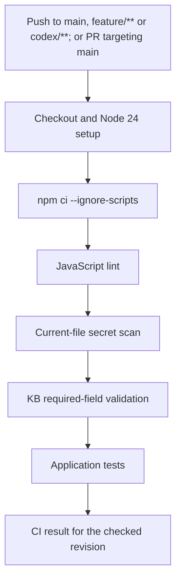

# Engineering controls: implementation, operation and review

Prepared: **2026-10-22**. Work branch: `codex/engineering-controls`.

Baseline: merge commit `5d40fdc23c97ef7b374300b36e67f4acb8cad0e8`, which merged [PR #1](https://github.com/Gichuru-123/knec-whatsapp-bot/pull/1).

Status: **implemented and verified locally; owner approved commit, push and pull-request creation on 2026-10-22**. Merge into `main` requires separate approval. This record captures pre-publication verification; subsequent remote CI evidence belongs to the pull request and its exact published revision.

**Post-merge update, 2026-10-23:** the owner subsequently approved the merge. [PR #2](https://github.com/Gichuru-123/knec-whatsapp-bot/pull/2) is merged into `main` at `1dae80e1538ba06b5c853940ff14f919ba5f3baf`, and [post-merge CI](https://github.com/Gichuru-123/knec-whatsapp-bot/actions/runs/39895439867) passed. Local `main` was synchronized and clean. This supersedes the pending merge/remote-CI status in the historical preparation record below; it does not alter its local verification evidence.

[Documentation index](README.md) | [Presentation and revision guide](presentation-guide.md) | [Phase 1 history](phase1-engineering-foundation.md) | [Phase 4 plan](phase4-twilio-plan.md)

## 1. Why this work exists

The original roadmap included automated engineering checks in Phase 1. The retrospective review found that the repository had tests and CI, but no configured JavaScript linter or explicit secret scanner. Adding these controls during Phase 4 reduces the chance of carrying avoidable mistakes into provider integration work.

The owner approved proceeding on 2026-10-22 and requested detailed documentation for revision and presentation. This work addresses the linting and secret-scanning portions of gap **E1**. Phase 4 remains open. Formatting tooling, branch protection and historical phase acceptance are separate unresolved items.

The practical objective is repeatability: another developer should be able to install the locked dependencies, execute the same checks and understand a failure without relying on a previous chat.

## 2. What each check establishes

| Check | Question it answers | Example failure | What passing does not establish |
| --- | --- | --- | --- |
| ESLint | Does JavaScript violate the configured static rules? | An undefined variable or an unused binding | Correct business requirements, every possible runtime path, security certification |
| Secretlint and file-inventory guard | Do selected current files contain a recognised credential pattern or a prohibited environment filename? | A GitHub-shaped token; a tracked private `.env` file | Absence of every possible secret, personal data, old-history leaks or staged-only content |
| KB required-field validation | Do the seven JSON articles contain the existing required fields? | Missing `source_url` | Factual accuracy, full schema conformance or permission to publish answers |
| Existing test suite | Do the implemented unit and local HTTP scenarios behave as asserted? | Wrong signature response, timeout behaviour or redaction | Successful live WhatsApp delivery, production capacity or KNEC acceptance |

These checks complement human review. A successful command is evidence about its defined scope.

## 3. Tools and dependency decision

All five additions are **development dependencies**, pinned without `^` or `~` in the manifest. The lockfile also records their transitive dependency resolutions and integrity values.

| Package | Pinned version | Purpose |
| --- | --- | --- |
| `eslint` | `10.13.0` | JavaScript lint engine and CLI |
| `@eslint/js` | `10.0.1` | ESLint's recommended JavaScript rules |
| `globals` | `17.13.0` | Recognised Node.js global names |
| `secretlint` | `13.0.7` | Credential-pattern scanner |
| `@secretlint/secretlint-rule-preset-recommend` | `13.0.7` | Maintained recommended credential detectors |

The official npm registry reported these versions and compatible Node engine requirements on 2026-10-22. The local runtime was Node **24.18.0**, npm **11.16.0**. The project continues to require Node 24.

Installation added **184 package entries**, all marked development-only in the lockfile. A structured comparison found **zero changes to pre-existing package entries**, including runtime packages. The install audit reported zero vulnerabilities at that time; this is a time-specific package advisory result, not an application security assessment.

The larger lockfile reflects the tools' dependency trees. Exact pins make updates deliberate; they do not establish that dependencies are immune to compromise. Dependency updates require review and rerunning the checks.

Dependency lifecycle scripts were disabled during installation and are disabled in the updated CI install step. The clean-install check below establishes whether the current locked toolchain works under this setting. A future dependency requiring an install script needs an explicit review of that requirement.

## 4. JavaScript linting design

Configuration: [eslint.config.cjs](../eslint.config.cjs).

The configuration covers JavaScript and CommonJS files under the checkout, including source, scripts, tests and the lint configuration. Generated dependency and coverage directories are excluded. It declares the existing CommonJS module style and Node globals, uses ECMAScript 2024 syntax, enables the recommended rules, and adds strict equality, `no-var` and `prefer-const`.

`npm run lint` uses `--max-warnings=0`: warnings cannot silently produce a passing result. Unused disable comments are errors, so stale exceptions are visible. The command checks files without rewriting them.

### Deliberate, narrow exceptions

| Location | Exception | Reason |
| --- | --- | --- |
| Abstract messaging adapter and dialog-manager interfaces | Unused arguments allowed in these two files | Their method signatures describe inputs that subclasses will consume |
| Express error handler | An unused argument named `next` is allowed in this file | Express recognises error middleware by its four-argument signature |
| KB repository's replacement startup error | One-line `preserve-caught-error` suppression | Attaching the original parsing error could retain article text in the exception chain |
| Secret-scan runner's replacement file-read error | One-line `preserve-caught-error` suppression | Shared scanner logs need a safe diagnostic rather than internal file-system details |

No rule is disabled across all source files to make an existing error disappear. Every exception has a specific reason and review location.

### Small source adjustments

The initial lint pass identified four unused bindings. Their removal changes no intended message flow:

1. The unused second argument of the unhandled-rejection callback in `src/index.js`.
2. The unused `next` parameter of the normal 404 handler. This is not the four-argument error middleware.
3. The unused caught-error binding in verified webhook JSON parsing; its safe 400 response is retained.
4. The unused request parameter of the mock signature method, which already returns `true` in mock mode.

The fifth source-file edit is the explanatory, single-line lint suppression in the KB repository. The existing regression suite and a direct error-handler arity check provide evidence for these adjustments.

### Formatting remains a gap

ESLint here checks selected correctness and consistency rules. This work does not introduce Prettier or a comprehensive formatting gate. Existing line-ending conventions remain in `.gitattributes`. Agreeing a formatter and reviewing its initial formatting diff is a separate bounded follow-up; do not mark all of E1 or Phase 1 complete from this change.

## 5. Secret-scanning design and boundaries

Configuration: [.secretlintrc.json](../.secretlintrc.json). Runner: [scripts/scan-secrets.js](../scripts/scan-secrets.js).

### File selection

The runner asks Git for tracked files and untracked files eligible for addition, using NUL-delimited filenames. This includes new work before a commit, handles spaces in Windows paths and includes tracked files even when `.gitignore` would exclude new files with that name.

It then:

1. Rejects private environment filenames such as `.env` and `.env.production` in the selected inventory. `.env.example` is allowed and scanned.
2. Rejects tracked generated dependencies and Git internals.
3. Rejects symlinks, submodules and paths resolving outside the checkout, rather than following them to external files.
4. Skips selected files deleted from the working tree. The staged-snapshot limitation below therefore matters.
5. Invokes the installed scanner directly with literal filenames and `.gitignore` filtering disabled for that explicit inventory.
6. Scans scanner-configuration files through standard input because Secretlint's normal file walker excludes its own configuration filenames.
7. Propagates findings and tool failures as unsuccessful exit statuses. A missing Git executable, missing scanner or empty selection fails the check.

An ordinary ignored, untracked private `.env` is outside the selected inventory and is not read by this command. The runner never imports application configuration or loads dotenv. No current project-specific secret allowlist or `.secretlintignore` is added.

### Detection and output

The recommended preset uses recognisable credential patterns, including supported provider tokens and private-key formats. It is not a universal detector for arbitrary passwords, Meta/Twilio credentials or personal information. Review future provider-specific coverage when implementing those integrations.

Secretlint's default masking remains enabled. Do not use `--no-maskSecrets` for shared reports. The wrapper does not use the CLI's `--output` option, whose success semantics differ from a normal lint failure. A deliberate synthetic token was used to check both rejection and output masking.

The checks operate locally after dependencies have been installed. They make no credential-validation calls to Meta, Twilio or GitHub and send no WhatsApp messages.

### Important limitations

- This command checks **current working-tree files**. It does not scan every Git commit or the Git staging area's stored file contents.
- If a secret is staged and then removed only from the working copy, this command can pass while the index still contains the older secret. Inspect the staged diff and ensure it matches the checked files before an approved commit.
- Historical commits, branches, tags, deleted historical files, archives and binary attachments need separately defined review coverage. Do not claim a full-history audit.
- A clean scanner result does not prove that a credential is absent, that a value is invalid, or that a provider account is secure.
- Rules, configuration and any future exclusions can weaken coverage. Treat changes to them as security-relevant review changes.
- No automatic Git hook is installed. Developers must run the documented checks before a commit and before an approved push.
- CI runs after content reaches GitHub. It can detect a problem at that stage; it cannot undo the initial exposure.

### Responding to a finding

Read the file location and rule name without copying the credential into chat, an issue or a screenshot. Determine whether the value is real or a deliberately public fixture.

For a real exposed credential, revoke or rotate it through the responsible account owner and assess where it was published. Deleting the current line does not erase Git history or invalidate the credential. History cleanup, when necessary, needs a separate coordinated plan.

For a false positive, prefer an obviously synthetic fixture. Any remaining exception must identify the exact rule, value or location and explain why it is safe. Do not exclude all tests, all documentation or whole source directories as a shortcut.

## 6. Local workflow: Windows and PowerShell

Use the repository directory. When receiving interactive guidance, run one command, inspect the output and share that result before taking the next step.

```powershell
Set-Location 'C:\Users\hp\Desktop\Application Docs\Projects\KNEC_DIGITAL_ASS\knec-whatsapp-bot'
```

Check the branch and outstanding changes:

```powershell
git status --short --branch
```

For a new checkout or when the lockfile changes, install the locked dependency set:

```powershell
npm ci --ignore-scripts
```

This replaces generated `node_modules` content in the current directory. Confirm the directory first. It does not require a private `.env` file. Keep development dependencies installed when running the engineering checks.

Run static JavaScript checks:

```powershell
npm run lint
```

Expected: exit code 0 and no findings. A failure normally identifies a file, line, column and rule. Review the code or the documented exception; do not disable a rule merely to obtain green output.

Run the secret scan:

```powershell
npm run scan:secrets
```

Expected: a success line with the selected-file count and exit code 0. The count changes as files are added. A credential finding should fail with masked output; an inventory/tool failure must also stop the workflow.

Run the existing KB check:

```powershell
npm run validate-kb
```

Expected: seven articles accepted by the required-field validator. Its existing phrase “fully verified” concerns this structural check; it must not be repeated as a claim of factual verification.

Run the existing application suite:

```powershell
npm test
```

Expected at this checkpoint: 77 passing tests. The test preload supplies public synthetic settings, bypasses personal dotenv data and uses fake local HTTP servers. Localhost connections must be permitted by the execution environment.

For routine use, the combined command performs those four checks in order and stops at the first unsuccessful command:

```powershell
npm run check
```

Before requesting publication approval, inspect the actual changes:

```powershell
git diff --check
```

```powershell
git diff --stat
```

Also review new files in VS Code: ordinary `git diff` does not show untracked file contents. After staging under an approved publication workflow, review `git diff --cached` and confirm the staged contents match the files checked. These instructions do not stage or publish anything automatically.

## 7. GitHub Actions behaviour

Workflow: [.github/workflows/ci.yml](../.github/workflows/ci.yml).



The existing workflow name, build job, Node 24 matrix and read-only repository permission are retained. `codex/**` is included so the new development branch can receive push checks after publication approval. Pull requests targeting `main` also trigger the workflow. No repository credential or provider secret is required by these checks.

All checks are sequential steps of the existing job. If installation, linting or scanning fails, subsequent normal steps do not run. The job does not deploy the application or connect a phone number.

A failed workflow prevents merging only when the repository's applicable branch protection or ruleset requires it and bypass permissions do not override it. This work does not change or certify those repository settings. Local success is not a substitute for a future successful run on the exact published revision.

## 8. File-by-file review map

| File | Change and purpose |
| --- | --- |
| `eslint.config.cjs` | New lint rules, Node/CommonJS settings and narrow signature exceptions |
| `.secretlintrc.json` | New recommended secret-detection preset |
| `scripts/scan-secrets.js` | New explicit file inventory, filename guards, masked scanner invocation and exit propagation |
| `package.json` | Five pinned development tools and three check commands |
| `package-lock.json` | Exact dependency resolution; existing entries retained |
| `.github/workflows/ci.yml` | Lint and secret scan steps, branch coverage and install-script restriction |
| `src/index.js` | Remove unused rejection-callback argument |
| `src/middleware/notFoundHandler.js` | Remove unused normal-middleware argument |
| `src/middleware/webhookBody.js` | Remove unused catch binding |
| `src/services/messaging/mockAdapter.js` | Remove unused mock method argument |
| `src/repository/kbRepository.js` | Explain one safe-error lint exception |
| `CONTRIBUTING.md` | Repeatable review commands, secret-handling and publication expectations |
| `README.md` | Entry point to the checks and detailed guides |
| `docs/README.md` | Current merge status, links and updated E1 scope |
| `docs/phase1-engineering-foundation.md` | Dated follow-up preserving the original historical findings |
| `docs/engineering-controls.md` | This implementation and operating record |
| `docs/presentation-guide.md` | Revision structure, speaking notes, evidence and likely questions |

## 9. Verification and acceptance record

Local verification date: 2026-10-22. Results below belong to this work and must not be relabelled as historical Phase 1 results.

| Operation | Observed result |
| --- | --- |
| Baseline Git inspection | Clean `main` at `5d40fdc`; new local work branch created |
| Registry lookup | Restricted-environment lookup failed with DNS resolution error; approved network execution returned the five pinned versions |
| Development-tool install with `--ignore-scripts` | Succeeded; 184 additions, 280 packages audited, zero advisory findings at the time |
| Existing lock-entry comparison | Zero pre-existing package entries changed; all additions marked development-only |
| First existing-suite attempt | Failed in the restricted environment during local HTTP scenarios; not counted as a pass |
| First lint pass | Six findings; unused bindings corrected and safe-error exceptions documented |
| Combined local check with localhost access | Lint and scan passed; seven KB files passed; 77 tests passed, zero failed |
| Deliberate undefined-variable probe via stdin | Rejected by ESLint with `no-undef`; clean JavaScript accepted |
| Synthetic credential probe via stdin | Rejected by Secretlint; synthetic token absent from captured output; clean text accepted |
| Express error-handler signature check | Four parameters retained |
| Fresh `npm ci --ignore-scripts` in an isolated temporary checkout | Succeeded: 279 packages installed, 280 audited, zero advisory findings at the time |
| Complete check in the fresh checkout | Passed: lint, scanner over 61 selected files, seven KB articles and 77 tests; zero test failures |
| New-file detection and literal filename handling | A synthetic token in an eligible new filename containing spaces and brackets failed the scan; output was masked |
| Tracked-but-ignored file probe | A force-added synthetic token file was still detected |
| Private environment filename probe | A tracked `.env.control-probe` was rejected with exit 2 |
| Ignored local environment probe | An untracked ignored `.env` containing only a synthetic test token stayed outside scan selection |
| Invalid scanner configuration and unavailable Git probes | Both failed with exit 2; clean temporary checkout passed after probe cleanup |
| Documentation checks | 11 Markdown files inspected; 72 local links/anchors resolved; no replacement-character findings |
| Diff whitespace check | `git diff --check` passed for this change |
| GitHub Actions for this work branch | Pending at preparation of this publication commit; consult the pull request checks for subsequent evidence |

The localhost-enabled rerun succeeded without changing the application to accommodate the restricted environment. The failed run and initial lint findings are retained here so the evidence does not imply every first attempt succeeded.

The first request to execute the isolated install was not executed: automatic approval review reported a usage-limit interruption. After the owner requested continuation, the approved retry succeeded. This was an approval-service interruption, not an installation failure or a determination that the command was unsafe.

The fresh checkout was prepared at `C:\Users\hp\AppData\Local\Temp\knec-engineering-controls-jZkZ9b`. Only repository-eligible files were copied; no private environment file or existing dependency directory was copied. Its local `verification-output.log` records the complete check output. Probe index/file changes occurred only inside that disposable checkout, with synthetic values and no commits, remotes or pushes. The main working repository's index was not used for these probes.

### Command record

These are the relevant implementation and validation commands actually executed. Registry and install commands required network access; HTTP tests required localhost access. Read-only file inspections and Git diff reviews supplemented them.

| Command / operation | Purpose and outcome |
| --- | --- |
| `git status --short --branch`, `git rev-parse HEAD`, `git ls-files` | Established baseline and reviewed final scope |
| `git switch -c codex/engineering-controls` | Created the local work branch after obtaining filesystem permission |
| `node --version`, `npm --version` | Confirmed Node 24.18.0 and npm 11.16.0 |
| `npm view <package> version engines license --json` for the five added packages | Confirmed official registry metadata after retrying outside the network-restricted environment |
| `npm install --save-dev --save-exact eslint@10.13.0 @eslint/js@10.0.1 globals@17.13.0 secretlint@13.0.7 @secretlint/secretlint-rule-preset-recommend@13.0.7 --ignore-scripts --fetch-retries=0 --fetch-timeout=30000` | Added the pinned development toolchain; succeeded |
| `npm test` | Initial restricted attempt failed during HTTP scenarios; later complete checks passed with localhost access |
| `npm run lint`, `npm run scan:secrets` | Initial lint findings repaired; subsequent individual checks passed |
| `npm run check` | Combined lint, scan, KB check and existing tests passed in the working checkout and fresh copy |
| `npm ci --ignore-scripts --fetch-retries=0 --fetch-timeout=30000` | Fresh install succeeded only in the isolated copy; did not replace the working repository's dependency directory |
| `git init --quiet` in the isolated copy | Supplied a separate Git inventory for scanner verification; no commit or remote created |
| Node assertions using stdin and temporary files | Verified failure detection, masking, file selection, configuration failure, missing Git and four-argument Express middleware |
| Node structured lockfile comparison | All original dependency entries retained; 184 added entries are development-only |
| Node Markdown link/anchor and encoding checks | 72 local references resolved across 11 Markdown files |
| `git diff --check`, `git diff --stat`, targeted full diffs | Reviewed whitespace, scope and the actual changes |

### Acceptance checklist

- [x] Explicit Node/CommonJS lint configuration with zero-warning command.
- [x] Explicit recommended secret-scanning rules and a local command.
- [x] Current-file selection includes eligible new files and tracked ignored files.
- [x] CI workflow includes the new checks and branch pattern.
- [x] Existing dependency entries preserved; runtime dependency declarations unchanged.
- [x] Existing application suite and KB check pass locally with localhost access.
- [x] Harmless negative probes demonstrate detection and output masking.
- [x] Clean install of the final locked dependency set independently confirmed.
- [x] Owner review and separate commit/push/pull-request approval, recorded on 2026-10-22.
- [ ] Successful GitHub Actions run for the eventual published revision.

## 10. Remaining work and next decision

The owner approved publication and pull-request creation on 2026-10-22. Inspect the published branch's actual CI result and review the pull request before requesting separate approval to merge into `main`.

The next feature proposal remains a bounded **offline Twilio adapter** work order, with synthetic tests and no live sending. Durable acceptance, duplicate handling and uncertain delivery require their own design before a controlled Sandbox exchange. Production number onboarding and institutional authority are later gates.

Outstanding engineering items include comprehensive formatting, confirmed branch rules, a full-history credential review if required, and a stronger application smoke-test definition. Content verification, operational ownership and Phase 4's live integration exit criteria remain open.

## 11. Official references

Consulted on 2026-10-22; pinned source files installed locally were also inspected to confirm CLI masking, exit behaviour and file-walker exclusions.

- [ESLint setup and runtime prerequisites](https://eslint.org/docs/latest/use/getting-started).
- [ESLint configuration files](https://eslint.org/docs/latest/use/configure/configuration-files).
- [ESLint unused-variable rule](https://eslint.org/docs/latest/rules/no-unused-vars).
- [Secretlint project and CLI documentation](https://github.com/secretlint/secretlint).
- [Secretlint configuration documentation](https://github.com/secretlint/secretlint/blob/master/docs/configuration.md).
- [Official npm package registry](https://registry.npmjs.org/) — queried with `npm view` for the five exact tool versions.

The implementation decisions, command results and project limitations above are repository-specific observations. Upstream documentation explains tool behaviour; it does not certify this project.
