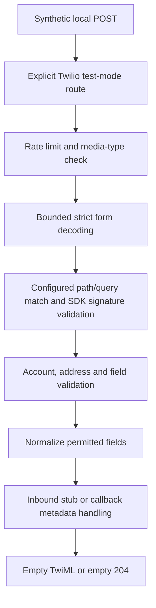

# Phase 4 work order: offline Twilio protocol foundation

Prepared: **2026-10-23**. Updated: **2026-10-24**. Status: **offline implementation verified; owner approved commit and push; publication execution and remote CI follow this record**.

Baseline: `main` at `1dae80e1538ba06b5c853940ff14f919ba5f3baf`, following the approved merge of [PR #2](https://github.com/Gichuru-123/knec-whatsapp-bot/pull/2). [Post-merge CI](https://github.com/Gichuru-123/knec-whatsapp-bot/actions/runs/39895439867) passed. The baseline had 77 tests. Preparation added no tests; the subsequent approved implementation adds 20, giving 97. Sections 2-14 preserve the agreed scope and acceptance contract; section 17 records what actually happened.

[Documentation index](README.md) | [Broader Twilio plan](phase4-twilio-plan.md) | [Presentation guide](presentation-guide.md)

## 1. Decision requested

The owner approved the bounded implementation, exact SDK dependency and offline verification below. A subsequent explicit approval on 2026-10-24 authorized the targeted `body-parser` security repair described in section 17. Commit, push, merge, public tunnelling, live messaging, account changes and spending remain separate decisions.

The owner requested this work order after the engineering-controls merge, reviewed its purpose and then approved implementation. Preparation and implementation are separately recorded so the original proposal is not mistaken for an earlier approval.

## 2. Why this is the next step

Phase 4 concerns the messaging connection. The project already has a shared adapter interface and Meta/mock implementations. Twilio uses a different webhook format and authentication procedure, so it needs its own adapter and routes.

The immediate deliverable is a reproducible demonstration that our code can authenticate and interpret Twilio-shaped requests, reject unsafe inputs and construct an outbound request against a fake transport. This creates evidence before introducing an account, public endpoint or paid exchange.

### Position in the remaining Phase 4 work

| Step | Intended result | Status / approval |
| --- | --- | --- |
| Engineering controls | Repeatable lint, secret scanning, KB checks and tests | Merged through PR #2; CI passed |
| **This work order** | Offline Twilio authentication, parsing, normalization, callbacks and simulated outbound contract | Approved and implemented locally; review/publication decision remains |
| Durable processing design and implementation | Persistent acceptance, duplicate control, outbox and delivery-state reconciliation | Separate work order before live use |
| Controlled Sandbox exchange | Evidence of a real inbound message, one diagnostic reply and observed delivery | Separate account, security, recipient and budget approval |
| Production sender onboarding | Authorized business identity, sender, operational ownership and production acceptance | Later institutional/account approval |

Completing this work order will not complete Phase 4. It does not start the Phase 5 menu or conversation engine.

## 3. Findings from the current repository

| Finding | Required bounded change |
| --- | --- |
| `AdapterFactory` returns Meta for every non-mock provider | Use explicit Meta/mock/Twilio cases and reject unknown providers |
| Configuration requires `WHATSAPP_VERIFY_TOKEN` in every mode | Retain that requirement for Meta/mock; Twilio must not need Meta credentials or a Meta GET challenge token |
| Current webhook route always uses the selected adapter | Mount provider-specific routes so mock authentication cannot authorize Twilio traffic, and Twilio cannot enter the Meta JSON path |
| Meta authenticates raw JSON before parsing it | Twilio form parameters must be decoded within strict limits before the SDK can validate the form signature; do not reuse Meta's JSON/HMAC middleware |
| Current handoff is a logging stub | Keep it a stub; no automatic reply, durable acceptance or delivery guarantee is introduced |
| Logger already redacts token fields and configured token values | Preserve those protections and add Twilio-specific disclosure regressions before considering any logger edit |
| CI already runs lint, scanner, KB validation and tests | Extend tests under the existing scripts; no new CI framework is needed |

## 4. Recommended offline boundary

For this first implementation, permit `WHATSAPP_PROVIDER=twilio` **only when `NODE_ENV=test`**. Reject it in ordinary development and production startup. This is a temporary, deliberate phase boundary: a later reviewed work order must enable a real development/Sandbox runtime.

`TWILIO_LIVE_SEND_ENABLED` defaults to `false`; `true` is rejected in this work order. The adapter's default outbound transport must be disabled and must fail before constructing a network-capable client. Only tests may explicitly inject a fake SDK HTTP client. Setting an environment variable must not enable a real send.

All integration tests use loopback-only HTTP or in-process request simulation and public synthetic settings. The configured external webhook URLs can use `https://example.test/...` because validation uses the URL string; tests do not contact that host.

`NODE_ENV=test` is a startup restriction, not a network sandbox. Do not expose the test application publicly or supply real credentials. The acceptance criteria also require a test transport that records calls and never opens a provider connection.

### Relationship to the broader plan

The older Twilio plan describes the eventual integration, including persistence, live REST sending and delivery tracking. This work order selects its protocol subset. Duplicate suppression, durable jobs, automatic replies, production credentials and real HTTP transport remain deferred. This explicit separation prevents offline 200/204 test responses from being mistaken for durable live acceptance.

## 5. Dependency proposal

Add **`twilio` exactly `6.2.0`** to application dependencies, with matching lockfile changes. The official npm registry reported version 6.2.0, Node `>=20.0.0` and an MIT licence on 2026-10-23; the project uses Node 24. No package was installed during preparation.

This belongs in application dependencies because signature validation is part of the future request-handling path. The package also contains REST support; the proposed offline boundary prevents its default network client from being used here.

Registry metadata lists six direct dependencies: `qs`, `axios`, `dayjs`, `xmlbuilder`, `jsonwebtoken` and `https-proxy-agent`. The later installation and advisory findings are recorded in section 17. Installing the SDK is a real dependency change, even while messaging remains offline.

After approval, use the exact version, disable lifecycle scripts during install, compare the lockfile against the baseline and report additions and any changes to existing entries. Do not perform an unrelated package upgrade or `npm audit fix`. Unexpected compatibility/security problems or changes to existing runtime resolutions require review before proceeding beyond this scope.

Sources: [Twilio's Node SDK](https://github.com/twilio/twilio-node), [version 6.2.0 metadata](https://registry.npmjs.org/twilio/6.2.0). The metadata lookup command was `npm view twilio version engines license dependencies --json --fetch-retries=0 --fetch-timeout=20000`.

## 6. Exact proposed implementation file list

This is the ceiling for the future implementation: **7 new files and 13 existing files, 20 total**. The new document itself already exists as a proposal; its later implementation record is an update. Additional files need an explanation and a scope decision before modification.

### New files after approval

| File | Responsibility |
| --- | --- |
| `src/services/messaging/twilioAdapter.js` | SDK signature validation, inbound/callback normalization, safe simulated outbound boundary |
| `src/middleware/twilioWebhookBody.js` | Bounded strict form decoding, duplicate-key and malformed-encoding rejection |
| `src/middleware/twilioWebhookAuth.js` | Signature-header checks, configured URL selection and safe authentication failure |
| `src/controllers/twilioWebhookController.js` | Invoke authenticated normalization and stub handling; return empty TwiML or callback acknowledgement |
| `src/routes/twilioWebhookRoutes.js` | Distinct inbound/status paths, rate limits, parser/authentication order and method handling |
| `tests/unit/twilioAdapter.test.js` | Signature, normalization, fake transport, deadline and safe-error scenarios |
| `tests/integration/twilioWebhook.test.js` | End-to-end local route, parsing, provider isolation, limits and privacy scenarios |

### Existing files allowed to change after approval

| File | Bounded purpose |
| --- | --- |
| `src/config/index.js` | Provider-specific settings, test-only Twilio mode, strict limits and disabled live-send gate |
| `src/services/messaging/adapterFactory.js` | Explicit provider selection without fallback |
| `src/app.js` | Mount Twilio routes only for Twilio; retain Meta/mock routes for their modes, before the general JSON parser |
| `.env.example` | Empty Twilio placeholders and clear test-only guidance; preserve the existing normal provider selection |
| `package.json` | Exact Twilio dependency; existing check/test commands should discover the new tests |
| `package-lock.json` | Reviewed SDK resolution and integrity metadata |
| `tests/helpers/testEnv.js` | Override all new settings with deterministic synthetic/empty test values |
| `tests/unit/configAndPrivacy.test.js` | Configuration and disclosure regressions; retain existing Meta/mock assertions |
| `README.md` | Actual implemented scope, commands and limitations |
| `docs/README.md` | Phase status and implementation evidence links |
| `docs/presentation-guide.md` | Explain the implemented offline path and its limits |
| `docs/phase4-twilio-plan.md` | Dated cross-reference clarifying which portions are implemented/deferred |
| `docs/phase4-twilio-offline-work-order.md` | Actual outcomes, file/dependency diff, failures and remaining gates |

The shared adapter interface, existing Meta/mock implementations, private `.env`, KB articles, logger and current CI workflow are outside the proposed edit list. If tests reveal a necessary change there, report the concrete reason before expanding the scope.

## 7. Request handling and provider isolation



### Routes and response contract

| Request / condition | Proposed result |
| --- | --- |
| `POST /api/v1/webhook/twilio/whatsapp`, valid text | 200 with XML content type and `<Response></Response>`; stub receipt only |
| `POST /api/v1/webhook/twilio/status`, valid callback | 204 with no response body; no conversational reply |
| GET or other unsupported method on these mounted paths | 405 with `Allow: POST`; no verification challenge |
| Twilio paths under Meta/mock configuration | Fixed 404; Twilio middleware is not executed |
| Existing Meta path under Twilio configuration | Fixed 404; Meta challenge/parser/authentication are not executed |
| Missing, duplicate or malformed signature header; invalid signature or configured path/query mismatch | Safe 401 after applicable bounded parsing |
| Unsupported media type, unsupported charset or compressed request body | Safe 415 |
| Body exceeds `WEBHOOK_BODY_LIMIT` | Safe 413 |
| Malformed form encoding, duplicate decoded parameter names or excessive parameter count | Safe 400 |
| Authenticated request with invalid account, address or required field | Safe 400 with no submitted values |
| Existing rate limit exceeded | 429; no authentication or downstream work |
| Unexpected internal failure | Standard safe 500; no body, credential, provider exception or stack disclosure |

Unsupported-method routing and inactive-provider responses must use fixed messages, avoiding reflection of the supplied URL/query. Existing Meta/mock successful behaviour must remain unchanged.

### Form parser contract

Use a route-scoped raw buffer bounded by the existing body limit, then strict UTF-8 and URL-form decoding. Do not use a parser that silently truncates parameters or converts repeated names into arrays before duplicate detection.

Project policy: maximum **100 form pairs**, no nested object interpretation, duplicate decoded names rejected, and no prototype mutation from names such as `__proto__`. Use a null-prototype parameter map or an equivalent safe representation. Preserve all valid decoded names and values, including unknown future fields, for signature validation. Interpret `+` as a form-space and `%2B` as a literal plus; reject invalid percent sequences and invalid UTF-8. Do not trim message text or signed values.

These size/ambiguity limits are project choices, not claims about Twilio's platform maximums. Parsing before form-signature verification is necessary here; it does not authorize logging or business processing before authentication.

## 8. Signature and URL decision

Use the official SDK's `validateRequest` with the configured Auth Token, the received `X-Twilio-Signature`, the appropriate configured external URL and **every decoded form parameter**. Twilio documents this form-validation contract; JSON body-hash webhooks are outside this work order. [Official request-security documentation](https://www.twilio.com/docs/usage/security).

Choose inbound versus status URL from the mounted route, not from request data. Validate HTTPS URLs without embedded user credentials or fragments. Keep the original configured string for signing; do not rebuild it with a URL serializer that can change escaping. A parsed URL can validate structure, while a preserved path/query string supplies the strict route comparison.

Before SDK validation, compare the raw incoming path and query with the configured endpoint's preserved path and query. Query reordering, changed percent encoding and unexpected trailing slashes must not silently become a different configured endpoint. Arbitrary `Host`, `Forwarded` and `X-Forwarded-*` headers never select the signature URL. Test that forging them does not authorize a signature for another host.

**SDK compatibility nuance:** the inspected 6.2.0 validator checks port and URL-encoding variants. Passing it a configured URL does not prove that the library performs only one byte-for-byte URL comparison. Keep the project's strict path/query binding and write characterization tests for the pinned SDK's URL variants. Do not disable signature checks or replace the SDK algorithm to make a fixture pass. If observed tolerance conflicts with the acceptance requirements, stop and document the decision needed. [Pinned SDK webhook source](https://github.com/twilio/twilio-node/blob/6.2.0/src/webhooks/webhooks.ts).

Signature validity authenticates the request data; it does not prevent replay. Persistence and duplicate control remain a separate requirement before live acceptance.

## 9. Proposed configuration

Validate Twilio-only settings when Twilio is selected. Existing Meta/mock settings must preserve their current required/optional behaviour. Automated tests overwrite all new environment settings and continue to skip private dotenv loading.

| Setting | Offline contract |
| --- | --- |
| `WHATSAPP_PROVIDER` | Explicit `meta`, `mock` or proposed `twilio`; unknown values rejected |
| `NODE_ENV` | Twilio accepted only with `test` in this work order |
| `TWILIO_ACCOUNT_SID` | Required synthetic `AC` followed by 32 hexadecimal characters; never echoed |
| `TWILIO_AUTH_TOKEN` | Required nonblank synthetic string without surrounding whitespace; no fallback or logging |
| `TWILIO_WHATSAPP_FROM` | Required synthetic `whatsapp:+E164` sender; plus followed by nonzero leading digit and at most 15 digits |
| `TWILIO_INBOUND_WEBHOOK_URL` | Required valid HTTPS URL with the inbound route's exact path and optional preserved query |
| `TWILIO_STATUS_CALLBACK_URL` | Required valid HTTPS URL with the status route's exact path and optional preserved query |
| `TWILIO_REQUEST_TIMEOUT_MS` | Strict decimal integer, proposed default 10000, range 100-30000 ms; simulated outbound deadline |
| `TWILIO_LIVE_SEND_ENABLED` | Missing/`false` means disabled; `true` or malformed values rejected for this work order |
| `TWILIO_TEST_RECIPIENT` | Required synthetic `whatsapp:+E164` recipient used as the one-recipient fake-send allowlist |

No real settings are requested from the owner at this stage. The account SID shape is a format check, not proof of account ownership. Test fixtures are deliberately public. Production API keys, secret rotation and credential provisioning are deferred.

The existing `WEBHOOK_BODY_LIMIT`, rate-limit settings and trusted-proxy configuration are reused. Do not add a second independent rate-limiter configuration or claim process-local rate limits are shared across servers.

## 10. Inbound and callback data contracts

### Inbound

After authentication, require the expected `AccountSid`, matching destination `To`, a WhatsApp `From`, a message SID in the accepted `SM`/`MM` plus 32-hex form, and a decimal integer `NumMedia` from 0 through 100. This media-counter bound is a project input limit, not a statement of Twilio's supported attachment count. Require a string `Body` for text messages; an absent body with no supported content is malformed. Empty text is handled as unsupported content and acknowledged without a reply. Preserve text exactly when it is present.

Map accepted text to the existing internal shape: `messageId`, digits-only `senderPhone`, `timestamp`, `type`, `textBody`, and `rawProvider: 'twilio'`. The timestamp is the application's receipt time in integer **seconds**, not a claimed sender timestamp. Document this provenance and avoid changing legacy Meta/mock timestamp conventions in this task.

Treat a message containing media as unsupported for this first slice, even when it has a caption. Return a controlled empty result/acknowledgement without downloading a URL, storing an attachment or forwarding caption text as an answered enquiry. Authenticated unknown fields participate in signature validation, then are discarded unless explicitly needed. [Twilio incoming webhook fields](https://www.twilio.com/docs/messaging/guides/webhook-request).

### Status callback

Authenticate using the distinct callback URL. Require the configured `AccountSid`, a valid message SID and a nonempty status string of at most 64 characters. If `From` is provided, compare it to the configured sender; if `To` is provided, compare it to the synthetic recipient allowlist. Do not reuse the inbound rule `To = configured sender`, because direction is reversed for outbound callbacks.

Normalize only SID, a recognised status or the fixed label `unknown`, an optional nonnegative safe-integer error code parsed from decimal digits, and receipt timestamp. The initial recognised labels are `accepted`, `scheduled`, `canceled`, `queued`, `sending`, `sent`, `delivered`, `undelivered`, `failed` and `read`; this mapping is not a delivery-state machine. Do not log arbitrary unknown status strings, provider error text or callback bodies. A valid unknown status is acknowledged without a crash or reply.

No database record or delivery-state machine is created. Repeated and out-of-order callbacks can be authenticated/acknowledged, but this does not establish ordering, reconciliation or deduplication. Twilio explicitly warns that callbacks may arrive out of order. [Official callback guidance](https://www.twilio.com/docs/messaging/guides/track-outbound-message-status).

## 11. Outbound simulation and error contract

`sendTextMessage(to, text)` must fail safely by default with a fixed disabled-send code. The factory-created adapter has no live transport. In unit tests only, inject a fake HTTP client compatible with the pinned SDK, then exercise `messages.create` request construction. Explicitly disable SDK automatic retries and provider debug logging.

Validate sender and recipient allowlist before the fake transport is invoked. Pass only `from`, `to`, `body` and the configured `statusCallback` needed for this slice. Return a minimal accepted result with the validated SID/status; do not return the SDK's complete response object or sensitive request history.

Exercise fake successful responses, authentication/HTTP failures, 429, malformed JSON, invalid success fields, rejected transport promises and a never-resolving fake request. Fixed safe errors may expose a validated HTTP status and a controlled category, but no provider message, response body, token, raw request or original `cause`.

The timeout test proves a bounded adapter wait against the injected transport. It does **not** prove cancellation of a real network request or a body-consumption deadline in Twilio's default HTTP client. That real-transport audit remains mandatory before live sending. A timeout or ambiguous failure must not trigger an automatic second send. Provider acceptance would not itself prove handset delivery.

The inbound controller never calls this send method in this work order. Empty TwiML contains no `<Message>` instruction. Therefore a repeated inbound fixture cannot produce a real or simulated automatic reply through the controller.

## 12. Tests and measurable acceptance criteria

Every new test uses public synthetic values. At least one signature fixture must be calculated independently with Node's crypto primitives, so a test does not merely sign and validate with the same SDK helper. Include an explicit test-transport call counter and assert zero invocations for disabled/unauthorized paths.

| ID | Required evidence |
| --- | --- |
| T1 | Explicit factory selection; unknown provider rejected; all existing Meta/mock tests retained |
| T2 | Twilio rejects non-test startup and any enabled live-send flag; no Meta credential required in Twilio tests |
| T3 | Valid signatures pass; missing, malformed, duplicate, wrong-token and modified-body signatures fail |
| T4 | Wrong configured host/scheme fixtures fail; raw path/query mismatch fails; forwarded/Host spoofing cannot select an alternate URL; pinned SDK URL tolerance is characterised |
| T5 | Unicode, spaces, literal plus, percent escapes and newly introduced fields preserve signing semantics |
| T6 | Malformed UTF-8/encoding, duplicate decoded keys, prototype-like names, more than 100 pairs, wrong media type, compression and oversized bodies have the documented safe outcomes |
| T7 | Wrong account/destination or malformed message identifiers rejected after authentication; text normalization and receipt-time units asserted |
| T8 | Unsupported media and empty content never fetch URLs or schedule replies |
| T9 | Callback authentication uses its own URL; direction-aware identity checks, unknown status and repeated/out-of-order fixtures remain safe |
| T10 | Fake outbound request fields and allowlist verified; absent fake transport blocks calls; fake errors/deadline do not leak or retry |
| T11 | Inactive provider paths and unsupported methods are fixed responses without reflected query values; shared rate limits remain effective |
| T12 | Responses and captured logs exclude synthetic tokens, body text, full phone numbers, provider errors and stacks; existing redaction tests remain green |
| T13 | `npm run check` and an isolated locked installation pass; existing 77 scenarios remain, with the actual new total reported |
| T14 | Final file diff stays within section 6; dependencies and disclosure findings are reviewed; actual commands and limitations documented |

These were the prospective acceptance criteria. The actual 97-test results and their limits are recorded in section 17.

### Verification sequence after implementation approval

1. Record the baseline branch, commit, working-tree state and existing check results; preserve user work.
2. Implement in an isolated review branch, add the pinned SDK and review dependency resolution.
3. Run the focused unit/integration tests and configuration/privacy regressions.
4. Run `npm run check`, inspecting each stage and the final test total.
5. Verify `npm ci --ignore-scripts` and the complete checks in a separate temporary copy; never replace the main checkout's dependencies accidentally.
6. Review all modified/new files, scanner findings, documentation links, actual call counts and safe logs.
7. Present actual results, failures and residual gaps; wait for separate publication approval.

When guiding the owner in PowerShell, provide one command at a time from the explicit repository directory and wait for the actual result. Automatic verification may use workspace tools after implementation approval, with registry access for package installation and localhost access for fake-server tests only.

## 13. Risks, mitigations and stop conditions

| Risk | Mitigation / remaining boundary |
| --- | --- |
| Mock validation accidentally authenticates Twilio traffic | Provider-specific mounting plus negative cross-provider tests |
| Decode/URL changes invalidate or weaken authentication | Preserve form values and configured URL string; strict raw path/query binding; pinned SDK characterization |
| SDK or fake client unexpectedly opens a network connection | Disabled default transport, explicit test-only injection and no real credentials; transport calls asserted |
| 200/204 mistaken for reliable live processing | Test-only provider restriction; documented absence of persistence; no public ingress approval |
| Dependency addition changes shared runtime resolution | Lockfile comparison; report unexpected existing-entry changes before proceeding |
| Timeout mistaken for confirmed rejection | Fixed unknown/timeout category, no automatic resend; real transport cancellation deferred |
| Scanner does not recognise every Twilio-shaped secret | Synthetic fixtures only, explicit privacy tests and manual review; no claim of universal secret detection |
| Callback identity/direction assumptions differ from actual account flow | Separate inbound/callback validation and source-backed fixtures; controlled live confirmation comes later |

Stop and explain if implementation needs extra files, schema/storage decisions, live access, costs, broader dependency changes, weakened authentication, blanket lint/scanner exclusions or a changed acceptance criterion. Preserve the work for review rather than resetting or deleting it.

## 14. Completion report and rollback

The completion report must include the exact commit baseline, files changed, dependency delta, commands and exit results, actual test totals, acceptance checklist, privacy findings and unresolved issues. Update this document and the presentation guide with the demonstrated behaviour, distinguishing synthetic evidence from live evidence.

No deployment or provider configuration is changed by the proposed work. During review, an existing approved Meta/mock environment remains usable. Do not edit the owner's private `.env` or switch it to Twilio. If the implementation is rejected, preserve the review branch; any later revert of a published change is a separate controlled action.

## 15. Explanation for presentation

Suggested explanation:

> We have implemented the first Twilio protocol slice locally. It authenticates synthetic Twilio requests, converts them into our internal message format and verifies outbound request construction against a fake client. The first slice has no live transport. Durable processing, a controlled Sandbox exchange and production sender onboarding have their own acceptance gates.

**Why no business number yet?** An adapter proves our software boundary. A business number also requires account ownership, sender onboarding and operational approval. Twilio's [production self-sign-up guide](https://www.twilio.com/docs/whatsapp/self-sign-up) describes the platform process; institutional authorization remains the project's responsibility.

**What will the next demonstration show?** Passing synthetic requests, deliberate authentication failures, correct normalized fields and a recorded fake outbound request. It will not show a WhatsApp handset receiving a message.

**What decision follows a successful implementation?** Review the diff and evidence, approve publication if satisfactory, then agree a durable-processing design before any live exchange.

## 16. Preparation evidence and approval record

- Inspected the merged baseline, adapter factory, configuration, app/router ordering, middleware and existing tests.
- Consulted official Twilio security, webhook, callback, SDK and sender-onboarding documentation on 2026-10-23.
- Queried official npm metadata; proposed `twilio@6.2.0`; installed no dependency.
- Created only a local planning branch and documentation changes. No application code, test implementation, private settings, account configuration or GitHub publication is part of preparing this proposal.
- Preparation changed five existing documentation files and added this work order. `git diff --check` passed; 79 local Markdown links/anchors resolved across 12 Markdown files, with no replacement-character findings. No application tests were run for this documentation-only preparation.
- Implementation approval: **received from the owner after reviewing the explanation of this work order**; continued in the 2026-10-23/24 work session.
- Live messaging / spending approval: **not requested at this stage**.
- Phase 4 completion: **not claimed**.

An approval of this work order authorizes sections 4-14 as a bounded offline implementation, including the exact SDK and synthetic verification. It does not authorize the deferred stages in section 2 or an automatic commit/push/merge.

## 17. Implementation and verification record

### Revision, scope and file review

Implementation branch: `codex/phase4-twilio-offline`. Baseline HEAD remains `1dae80e1538ba06b5c853940ff14f919ba5f3baf`. There is no implementation commit or remote CI result yet. The implementation uses the seven new and thirteen existing files listed in section 6. The preexisting planning update to `docs/engineering-controls.md` is preserved separately; it is not an extra implementation edit.

| Component | Implemented behavior |
| --- | --- |
| Configuration/factory | Explicit provider selection; Twilio restricted to test; frozen validated endpoint settings; live-send flag cannot enable transport; no Meta credentials required for Twilio |
| App/routes | Twilio and Meta/mock routes isolated; Twilio POST-only with fixed safe fallback responses; shared process-local rate limiter |
| Form middleware | Raw byte limit, uncompressed form-only input, strict UTF-8 and percent decoding, 100-pair maximum, decoded duplicate rejection, null-prototype scalar map |
| Authentication | Exactly one well-formed signature header; original path/query bound to configured endpoint; all scalar fields validated with official SDK; host/proxy headers ignored for URL selection |
| Inbound controller | Validates identity, normalizes text with receipt seconds, invokes existing handoff, returns empty TwiML; media/empty text yield no supported messages |
| Callback controller | Distinct URL and outbound direction checks; fixed unknown-status label; selected receipt metadata only; 204 response |
| Outbound adapter | Disabled unless a test explicitly injects a client; one-recipient allowlist; text length 1-1600 JavaScript code units; only required request fields; minimal SID/status result |
| Failure handling | No automatic SDK retry; bounded simulated wait; fixed categories without provider body/cause; HTTP and validation responses pass through existing safe handler |
| Tests/docs | Independent crypto signature fixtures, real local routes, fake SDK call counters, privacy capture, detailed revision and demonstration guidance |

The 1600-code-unit text bound is a project input limit for this slice, not a claim about every Twilio encoding or WhatsApp limit. Callback normalization retains an optional numeric error code, but the unchanged logger redacts keys containing `error`; logs are not a delivery database.

### Dependency changes and approved security repair

- Added runtime dependency `twilio` pinned exactly to **6.2.0**, installed with lifecycle scripts disabled.
- The SDK introduces **25 package paths** into the lockfile. Seven existing packages become runtime dependencies as well as development dependencies: `asynckit`, `combined-stream`, `delayed-stream`, `es-set-tostringtag`, `form-data`, `has-tostringtag` and `semver`. Their versions remain unchanged.
- The first SDK install reported zero audit advisories. A later fresh locked installation reported one high-severity advisory against the existing **body-parser 1.20.8**, also present in baseline `main`. This demonstrates why a previous clean audit is not permanent evidence.
- The maintainers identify a denial-of-service flaw involving trailing bytes after compressed request bodies and list **1.20.9** as the patched 1.x release: [official advisory](https://github.com/expressjs/body-parser/security/advisories/GHSA-27r3-jxmh-p828), [release](https://github.com/expressjs/body-parser/releases/tag/1.20.9).
- The owner explicitly answered **“Approve targeted security repair”** on 2026-10-24. `npm update body-parser --ignore-scripts --fetch-retries=0 --fetch-timeout=30000` changed one installed package and reported zero advisories. Lockfile review confirms **1.20.8 → 1.20.9 is the only existing package version change**. No blanket `npm audit fix` or unrelated upgrade was used.
- The Twilio parser already rejects compression, but the application also has other parsers. Their presence means the dependency finding cannot be dismissed solely because the new Twilio route blocks compressed forms. The dependency update addresses the shared parser version. This work does not claim an exploit reproduction or a complete dependency security audit.

### Executed checks and observed failures

Environment: Windows PowerShell, Node **24.18.0**, npm **11.16.0**. Human-facing date: **2026-10-24, Africa/Nairobi**; retained logs can carry the previous date in UTC.

| Check | Actual result |
| --- | --- |
| Baseline `npm run check` | Passed: 77 tests and seven KB files before implementation |
| Initial lint | Failed on a control-character regex and an unnecessary lint suppression; both corrected without changing lint rules |
| Initial restricted focused tests | Loopback connections blocked with EACCES; this was an environment failure |
| Focused tests with localhost access | Exit 0: 44 tests passed, zero failures; includes existing configuration/privacy tests |
| First combined check | Secret scanner flagged a synthetic credential-bearing URL literal in a rejection test; fixture now constructs that URL from explicit public fixture fields, retaining the rejection assertion; no scanner exclusion added |
| Complete local check before security update | Exit 0: lint, secret scan, seven KB files and 97 tests; zero failed/skipped/cancelled |
| First isolated `npm ci --ignore-scripts` | Exit 0; installed 304 packages, audited 305; reported the existing high-severity parser advisory |
| First isolated `npm run check` | Exit 0: 97 tests and all preceding stages passed; this result alone did not clear the advisory |
| Targeted parser repair | Exit 0; one package updated, zero audit advisories reported |
| Final local `npm run check` after repair | Exit 0: lint, current-file secret scan, seven KB files and all 97 tests passed; zero failed/skipped/cancelled |
| Final fresh `npm ci --ignore-scripts` after repair | Exit 0: 304 packages installed, 305 audited; zero reported vulnerabilities |
| Final isolated `npm run check` after repair | Exit 0: lint, current-file secret scan, seven KB files and all 97 tests passed; zero failed/skipped/cancelled |
| Final scope/dependency/document review | 13 approved existing files changed and seven approved new files; no out-of-scope implementation edits; preexisting engineering-controls document unchanged; all 83 local links/anchors resolve across 12 Markdown files; `git diff --check` and new-file whitespace checks passed |

Focused command:

```powershell
node --require ./tests/helpers/testEnv.js --test tests/unit/twilioAdapter.test.js tests/integration/twilioWebhook.test.js tests/unit/configAndPrivacy.test.js
```

Full command: `npm run check`. The isolated install uses `npm ci --ignore-scripts --fetch-retries=0 --fetch-timeout=30000`, then `npm run check`. A uniquely named host temporary directory contains only eligible repository files plus a temporary Git inventory for the scanner; it excludes private environment files and the original `node_modules`. Each installation command verifies its exact working directory first. The original checkout's dependency directory is never used as the fresh-install target.

Final local output is retained at `%TEMP%\knec-twilio-final-check.log` in the host user environment. The final isolated copy is `%TEMP%\knec-twilio-final-ci-Eks3YI`, with `install.log` and `check.log`. These are local review artifacts, not committed files. Source/tests/manifests in that copy match the verified implementation; this completion-record update was written after the checks to record their actual results. Final document/link and secret checks cover the completed record. The final installation audited the repaired dependency graph; zero reported advisories is a dated scanner result, not a guarantee against undisclosed vulnerabilities.

Relative to Git HEAD, the review contains 21 changed/new paths because the already-existing `docs/engineering-controls.md` planning update is included. A pre-implementation SHA-256 inventory confirms that file was preserved, and the implementation itself changed exactly the approved 20 paths. The only existing package resolution change is the separately approved parser patch; all 25 added package paths resolve from the npm registry with integrity metadata.

### Acceptance mapping

| Criteria | Evidence and practical limit |
| --- | --- |
| T1-T2 | Factory/configuration tests plus retained legacy suite; test-only Twilio and disabled default sends |
| T3-T5 | Independent HMAC fixtures, duplicate-header cases, host spoofing, exact path/query checks, Unicode/plus/unknown fields and pinned SDK variant characterization |
| T6 | Real route tests reject malformed raw UTF-8, percent encodings, duplicate decoded keys, excess pairs, unsupported content/compression and oversized bodies; prototype-like names remain scalar fields |
| T7-T8 | Identity/field failures, precise text normalization, receipt-time units, no fetch for media, empty TwiML and zero automatic send calls |
| T9 | Separate callback URL, address direction, unknown statuses and repeated/out-of-order receipt tests; no durable state or reconciliation claim |
| T10 | Recorded fake SDK fields, invalid recipient prevention, default send failure, safe HTTP/JSON/transport errors, one call per attempt and bounded fake deadline |
| T11-T12 | Active/inactive route and method checks, shared rate limit, captured logs and safe responses; no tested disclosure of fixture token, text, full phones, provider errors or stacks |
| T13-T14 | Full/fresh checks and final file/link review are recorded above and below; local evidence must not be presented as published CI |

### Remaining approval gates and limitations

The intended next decision is review of the local diff and evidence, followed by separate commit/push approval. Publication would need a CI result for the exact new revision and separate merge approval. The implementation does not complete Phase 4 or begin Phase 5.

Before live use, agree persistent acceptance, deduplication, outbox delivery and callback reconciliation; audit a real outbound transport; approve account ownership, recipient, public ingress and budget; then demonstrate a controlled Sandbox exchange. Production sender onboarding, verified KB content, governance and institutional acceptance remain open. Tests prove selected synthetic behavior, not freedom from every defect.

## 18. Publication approval

On 2026-10-24, after receiving the completion report and the request to review before commit/push, the owner answered **“i approve everthing”** and subsequently **“Continue”**. This authorizes committing and pushing the reviewed offline implementation, security patch and documentation to `codex/phase4-twilio-offline`. Opening a review pull request and checking the published revision are part of publication. Merge into `main`, live messaging and later engineering stages remain separate decisions.

Sections 16-17 and the linked guides describe the pre-publication checkpoint. This dated approval supersedes their statements that publication approval was pending; it does not turn local test results into remote CI evidence. The publication report and pull request must identify the actual commit and GitHub checks once available.

An initial remote branch check was not executed because automatic approval review reached its service usage limit. After the owner's continuation, the same normal approval process succeeded: remote `main` still pointed to baseline `1dae80e`, and the Twilio feature branch did not yet exist remotely. No approval check was bypassed.
