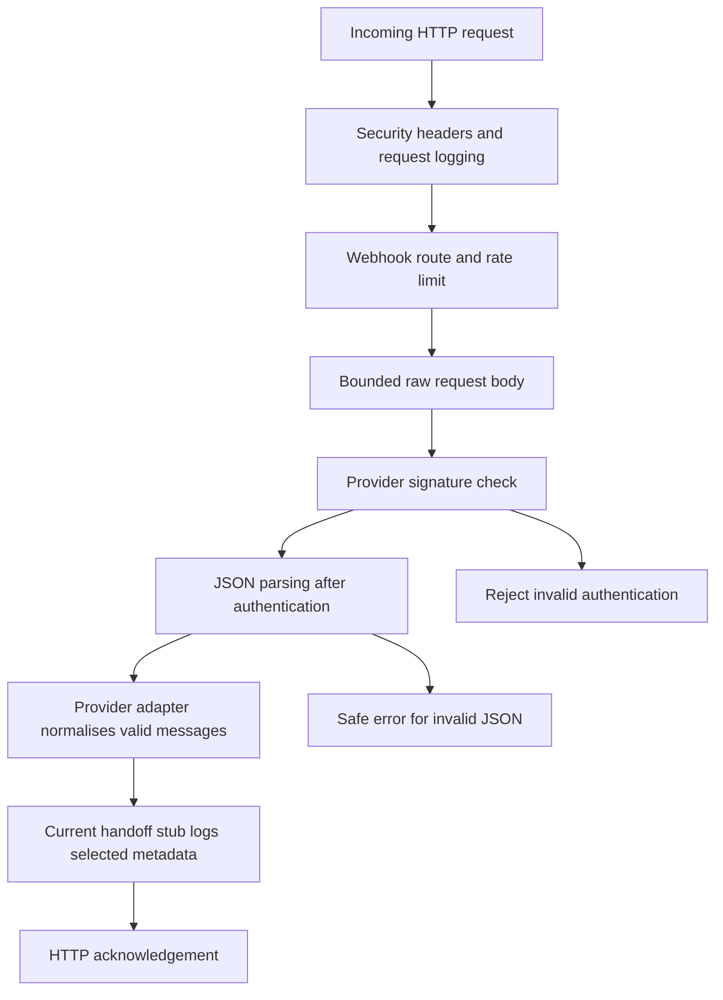
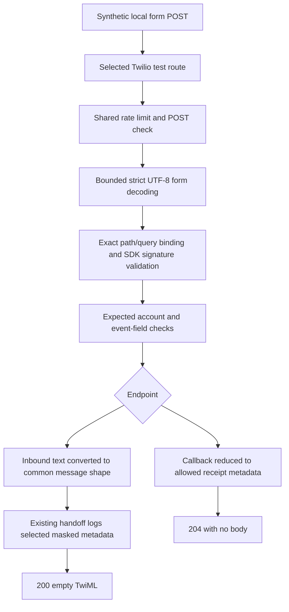

# KNEC Digital Assistant: presentation and revision guide

> Current consolidated status: [Phase 2 handover](phase2-kb-handover.md). Dated checkpoints below retain the history of this work.


Prepared: **2026-10-22**. Updated: **2026-10-31**. Use alongside the [documentation index](README.md) and [engineering-controls record](engineering-controls.md).

This guide describes the software foundation, engineering controls and approved offline Twilio implementation. PR #1 and PR #2 are merged into `main`. The engineering-controls merge is `1dae80e`, with [successful post-merge CI](https://github.com/Gichuru-123/knec-whatsapp-bot/actions/runs/39895439867). PR #3 merged the offline Twilio foundation at `34b4177`. The PostgreSQL delivery implementation is local on `codex/phase4-delivery-safeguards`, with publication and live activation still pending. Its [completion evidence](phase4-twilio-offline-work-order.md#17-implementation-and-verification-record) records the subsequent checks. Earlier verification tables retain their original dates and scope.

## 1. Start with a precise project description

Suggested opening:

> We are developing a WhatsApp information-assistance platform intended for KNEC-related public information. The repository contains a backend foundation, a structured knowledge base, Meta/mock adapters, a tested offline Twilio adapter and automated checks. Real Twilio connectivity, a live business number, the conversation engine and approved public-answer delivery remain future work. Institutional adoption requires technical, content and stakeholder acceptance.

Explain the intended value: a consistent way to receive enquiries, retrieve approved information and eventually escalate cases that require human assistance. Distinguish the intended service from what the current code demonstrates.

## 2. Project status by phase

| Phase | Explain this purpose | Evidence available | Open work |
| --- | --- | --- | --- |
| 0: Definition | Establish scope and architecture | Repository project outline; fuller local planning material | Reconcile and approve a portable governing specification |
| 1: Engineering | Make development repeatable and reviewable | Repository, manifests, configuration, tests, CI; new local lint and scanner controls | Formatting, confirmed repository governance and formal acceptance evidence |
| 2: Knowledge | Store information with provenance metadata | Seven JSON articles and a required-field validator | Full schema, content-owner review and publication rules |
| 3: Backend | Handle requests through defined components | Express app, health endpoint, repository/service layers, logging and errors | Operational ownership, retention/access decisions and production acceptance |
| 4: Messaging | Establish provider interfaces and webhook boundaries | Meta/mock foundation; local Twilio protocol handling; authentication, limits, safe errors and offline tests | Final delivery verification/publication review, live exchange and production onboarding |
| 5 onward | Add conversation and information-delivery capabilities | Roadmap and planned interfaces | Menu/state engine, integrated answers, escalation, deployment and stakeholder review |

The Phase 1-3 reports were written retrospectively on 2026-10-20. Describe them as reconstructed implementation evidence, not original sign-off documents.

## 3. Understand the present request flow



This diagram explains the Meta webhook path. Its raw bytes matter because signature verification depends on the exact received body. The implemented Twilio form route has its own ordering, described in section 10. Normalisation gives downstream code a common message representation.

The handoff is currently a stub. It does not select an approved KB answer or send an automatic reply. The presence of an outbound adapter method does not establish that the inbound flow calls it. In-memory handling also does not provide durable delivery guarantees after a process crash.

### Files to recognise in VS Code

| File or area | Plain-language explanation |
| --- | --- |
| `src/app.js` | Assembles application middleware and routes |
| `src/config/index.js` | Validates startup settings and rejects unsafe combinations |
| `src/middleware/webhookBody.js` | Controls request-body handling and authenticated JSON parsing |
| `src/middleware/webhookAuth.js` | Applies the selected provider's signature validation |
| `src/services/messaging/metaAdapter.js` | Implements Meta-specific message handling and outbound method |
| `src/services/messaging/mockAdapter.js` | Supports controlled local development without a real provider |
| `src/services/messaging/twilioAdapter.js` | Authenticates Twilio forms, normalizes events and constructs requests through an injected test client |
| `src/middleware/twilioWebhookBody.js` | Decodes bounded UTF-8 forms and rejects ambiguous or malformed fields |
| `src/routes/twilioWebhookRoutes.js` | Separates inbound and callback paths; applies method, rate and authentication checks |
| `src/services/messaging/conversationHandOff.js` | Current downstream stub |
| `src/repository/kbRepository.js` | Loads and indexes the local articles |
| `knowledge-base/` | Stores the seven content records and metadata |
| `tests/` | Contains the existing automated scenarios and synthetic settings |
| `.github/workflows/ci.yml` | Defines checks GitHub runs for a published revision |

## 4. Explain the new engineering controls

### Linting

Suggested explanation: “Linting reads our JavaScript against explicit rules. It can identify an undefined variable before that line is reached during execution. Our configured command treats warnings as failures, and narrow exceptions are documented.”

The lint command does not run the WhatsApp service or automatically rewrite the repository. Passing it does not prove every requirement has been implemented.

### Secret scanning

Suggested explanation: “Secret scanning examines the current repository files for supported credential patterns. Our runner also rejects tracked private environment filenames. Findings are masked, and a failed scan stops the combined check.”

An ignored local `.env` is a file-management convention, not a full security control. A recognised credential pasted into source or a document can still be found. Arbitrary passwords and historical commits are outside the guarantee of this configured check.

### Tests

Suggested explanation: “Tests exercise defined behaviour using synthetic data and local fake servers. Our current local application suite contains 97 passing tests: the previous 77 and 20 new Twilio scenarios. They cover invalid signatures, strict forms, provider isolation, request limits, configuration rejection, privacy and simulated outbound timeouts.”

The test count is evidence of executed assertions. It is not a percentage of production readiness. The original smoke test is an arithmetic assertion; do not describe that particular test as application-startup proof.

### Continuous integration

Suggested explanation: “CI reruns the recorded installation and checks on GitHub for a particular revision. This helps reviewers reproduce local results. Whether it blocks a merge depends on the repository's required-check rules.”

The workflow passed on the engineering-controls feature branch, pull request and merged `main` revision. That linked remote result covers the older 77-test revision. The 97-test Twilio result is local evidence until publication and a successful CI run for the new revision.

## 5. Suggested ten-minute presentation

| Time | Topic | What to show |
| --- | --- | --- |
| 0-1 minute | Problem, intended users and service boundary | Precise opening description |
| 1-2 minutes | Phase status | Phase table and outstanding work |
| 2-4 minutes | Architecture and current message path | Flow diagram and adapter/handoff files |
| 4-6 minutes | Security and engineering controls | Configuration, safe errors, lint/scanner setup |
| 6-8 minutes | Evidence | Review record, actual check output and relevant test names |
| 8-9 minutes | Knowledge quality and operational gaps | Unverified content status, durability and ownership requirements |
| 9-10 minutes | Next decision | Review the offline Twilio diff and evidence, then seek publication approval; explain the later durability gate |

Practise explaining the purpose of each layer before its filename. If asked to demonstrate a capability that is still planned, show its plan and status clearly.

## 6. Safe demonstration sequence

Prepare the software and dependencies before presenting. Use the one-command-at-a-time instructions in the [operating guide](engineering-controls.md#6-local-workflow-windows-and-powershell).

1. Show `git status --short --branch`, identify the branch, and state whether the change is local, published or merged.
2. Open `docs/README.md` so the audience can find the phase reports.
3. Open the lint configuration and explain one rule and one justified exception.
4. Run `npm run lint` and explain its actual exit result.
5. Open the scanner configuration and runner; run `npm run scan:secrets` and explain its working-tree scope.
6. Run `npm run validate-kb`, explaining that required fields do not establish factual approval.
7. Run `npm test`; show the final totals and a few relevant test names.
8. Show the CI workflow and the actual GitHub run for the revision being discussed, if it has been published and checked.
9. End with the outstanding work and the specific decision sought.

Use synthetic data and safe output. Do not open a private `.env`, account settings, access tokens or candidate records during the presentation. A local demonstration of these checks needs no Twilio subscription, phone-number purchase or live message.

## 7. Likely questions and accurate answers

### Is the WhatsApp assistant already live?

No live exchange has been demonstrated. Meta/mock foundations and a test-only Twilio implementation exist. Live testing and production onboarding require later approved work.

### Why strengthen Phase 1 controls while working on Phase 4?

The retrospective review identified an unfinished foundation requirement. Adding repeatable checks now helps protect subsequent integration work. It does not move the project to Phase 5 or close the Phase 4 integration gate.

### Why use both linting and tests?

Linting checks code patterns without exercising application scenarios. Tests exercise selected behaviour. Each can catch mistakes that the other misses.

### Does a green secret scan mean there are no secrets anywhere?

No. It means the selected current files passed the configured detector rules and filename checks. Historical Git objects, staged-only content and unrecognised secret formats need separate attention.

### Will these checks stop every bad merge?

The commands can fail, and CI records that failure. Enforced merge blocking depends on the applicable branch rules and permissions. Those settings have not been certified by this work.

### Has KNEC verified the information in the knowledge base?

No recorded content-owner approval is established by this checkpoint. The seven articles pass a required-field check, while full schema enforcement and factual verification remain open.

### Can the system retrieve a candidate's private results?

No authorised private-record integration is implemented. Such access would require institutional authority, an approved interface and an appropriate identity/access design.

### Is Twilio the same as the WhatsApp business number?

Twilio would provide the messaging integration. A production WhatsApp sender also requires the relevant business ownership and onboarding process. An adapter, a Sandbox and an approved production sender are separate milestones.

### Is this ready for institutional adoption?

The project is being developed towards institutional requirements. Adoption still depends on verified content, reliable delivery and recovery, operational ownership, security review, approved live integration and stakeholder acceptance. Current tests alone cannot establish those conditions.

### What happens next?

Review the completed offline Twilio changes and approve publication if satisfactory. After publication and remote CI review, the next proposed engineering work is durable processing: preserving accepted messages, controlling duplicates and recording outbound jobs. That design requires its own work order before a controlled live exchange.

## 8. Short glossary

| Term | Meaning in this project |
| --- | --- |
| Adapter | A component translating a provider's API and messages into the application's expected interface |
| Webhook | An HTTP request a provider sends to our configured endpoint when an event occurs |
| Signature | A cryptographic value used to check that a request matches the expected sender's shared secret and signed data |
| Lint | Static checks against explicit source-code rules |
| Secret | A credential that grants access or authenticates requests and must not be published |
| Fixture | Deliberately controlled sample data used by tests |
| Lockfile | The recorded package dependency resolution used for reproducible installation |
| CI | Automated checks run for a published code revision |
| Branch | A line of development kept separately from another branch such as `main` |
| Commit | A recorded Git snapshot with an identifier |
| Push | Publishing commits to a remote repository |
| Pull request | A review proposal to bring one branch's changes into another |
| Merge | Incorporating approved branch history into its destination |
| Durable processing | Keeping accepted work in persistent storage so it can survive a process restart |
| Idempotency | Ensuring repeated processing of the same operation does not create unintended duplicate effects |

## 9. Final revision checklist

- Can I describe what is implemented, what is only planned and what has actually been tested?
- Can I trace a message through the current webhook path without claiming an automatic KB reply exists?
- Can I explain why seven structurally valid articles are not seven approved articles?
- Can I distinguish local changes, a push, a successful CI run and a merge?
- Can I explain the limits of linting, secret scanning and the local 97-test result?
- Can I name the next decision and the evidence needed before it?

Use the technical [engineering-controls record](engineering-controls.md#9-verification-and-acceptance-record) for exact implementation evidence. Use the phase reports for historical context. Keep both current as approved work progresses.

## 10. Explain the implemented offline Twilio path

### What it does and why

Twilio delivers form fields, while Meta delivers JSON. The separate adapter translates those provider-specific inputs into the application's existing message shape. Keeping that translation at the boundary allows later conversation logic to use common fields without learning each provider's protocol.



The form must be decoded before Twilio's signature can be checked, because that signature uses decoded parameter names and values. The parser therefore has strict size, encoding, duplicate-key and field-count rules. All received scalar fields, including unknown fields, participate in authentication. Only authenticated events proceed to identity validation and normalization.

The signature uses the configured HTTPS endpoint string. Incoming `Host` and forwarded headers cannot change it. The raw path and query must match configuration, including query order and escaping. The pinned SDK accepts certain port/URL-encoding variants; characterization tests record that behavior. Authentication does not prevent replay.

### Walk through a synthetic text message

1. A local fixture supplies an account SID, message SID, sender, destination, `NumMedia=0` and text. Its signature is independently calculated with Node crypto.
2. The configured Twilio test route validates the form and signature, then checks the account and destination.
3. The adapter returns message ID, digits-only sender, text, type and provider. Text is preserved exactly. The timestamp records application receipt in seconds.
4. The existing handoff logs selected metadata with a masked phone number. It does not choose a KB answer.
5. The response is `<Response></Response>` with HTTP 200. It contains no instruction to send a message.

An empty text or media fixture produces no supported message. Media URLs are never fetched, and captions are not forwarded as answered enquiries. A repeated fixture may reach the handoff again; durable deduplication is not implemented.

### Explain the outbound and callback demonstrations

The default `sendTextMessage` call fails with `TWILIO_SEND_DISABLED`. A unit test must explicitly inject a recording fake HTTP client before the SDK can construct an outbound request. The test checks sender, one allowed recipient, body and callback URL. Text is bounded to 1-1600 JavaScript string code units for this project slice. No provider connection is opened.

Fake HTTP failures and malformed responses become fixed safe errors. A stalled fake request produces `TWILIO_ACCEPTANCE_UNKNOWN` after the configured wait, with no automatic retry. This demonstrates a bounded adapter wait; it does not establish cancellation of a real network operation or delivery to a handset.

Callback fixtures use their own URL and outbound address direction. Known statuses are retained; other valid strings become `unknown`. Repeated and out-of-order callbacks receive a safe acknowledgement, but there is no stored delivery history or state reconciliation. The normalized optional numeric error code is currently redacted by the shared logger's error-key policy; raw provider error messages are discarded.

### Demonstration commands

From the verified project directory, with locked dependencies installed, run this focused command and inspect its result:

```powershell
node --require ./tests/helpers/testEnv.js --test tests/unit/twilioAdapter.test.js tests/integration/twilioWebhook.test.js tests/unit/configAndPrivacy.test.js
```

Recorded result: **44 passing tests**. It includes existing configuration/privacy tests, so it is not a count of 44 new Twilio tests. For the complete repository checks, run `npm run check` separately; the recorded total is **97 passed, zero failed or skipped**. Localhost access is required. Do not start a public server or copy fixture credentials into `.env` for this demonstration.

### One-minute presentation summary

> We have implemented and locally tested the Twilio protocol boundary. Synthetic signed forms are authenticated, normalized and acknowledged, and unsafe forms are rejected. A fake client confirms how an outbound request would be constructed. Live sending remains disabled. The complete local suite passes 97 tests. Before real use, we still need durable acceptance and duplicate control, a reviewed real transport, an approved Sandbox exchange, verified content and institutional onboarding.

### Evidence versus remaining work

| Demonstrated locally | Still required before the relevant live milestone |
| --- | --- |
| Official SDK validates synthetic signatures | Real account and endpoint compatibility in an approved exchange |
| Strict forms and provider isolation | Reviewed public ingress, deployment and operational controls |
| Fake outbound construction, safe failures and bounded wait | Real HTTP cancellation/acceptance audit and controlled sending |
| Safe callback normalization | Persistent delivery records, ordering and reconciliation |
| No automatic replies | Durable jobs and approved conversation/answer logic |
| Local checks and locked-install evidence | Separate publication approval and CI for the exact published revision |

## Explaining PostgreSQL in the architecture

The database preserves processing state. The backend authenticates and coordinates requests; the conversation engine will decide the next conversation step; the knowledge base supplies approved service information. These are separate responsibilities.

For Phase 4, an accepted inbound event and its pending reply are saved together. Unique account/message identifiers prevent duplicate jobs. A worker reserves an attempt before contacting Twilio. Callbacks update the matching provider SID. A crash during sending leaves an uncertain outcome, requiring investigation rather than an automatic duplicate reply.

The local PostgreSQL 18 instance is separate from existing projects. Development and disposable test databases have different roles. Migration credentials change schema; runtime credentials perform approved table operations. Synthetic backup/restore evidence demonstrates a basic recovery procedure, not production high availability.

Future conversation sessions and knowledge publishing can add reviewed migrations. Production hosting, capacity, data governance and recovery objectives still require institutional decisions. Current demonstrations must be described as development work: a live KNEC-backend WhatsApp exchange and Phase 4 sign-off remain outstanding.

### Verification status — 2026-10-31

Local fresh-install checks passed 109 tests, lint, secret scanning and KB structure validation. The npm audit also reported seven affected dependency entries, including one high-severity advisory. Security remediation is under review; passing functional tests does not resolve dependency advisories. See the delivery work order for exact packages and proposed fixes.

### Security repair evidence — 2026-10-31

The approved targeted dependency repair passes 109 working-tree tests, lint, secret scanning and KB structure validation. The installation audit reports zero advisories at this checkpoint. Minimatch compatibility was checked against 651 repository-pattern cases and intentional ESLint violations. Earlier advisory counts describe the pre-repair state; consult the delivery work order for fresh-install confirmation and exact versions. These checks do not establish live WhatsApp delivery or institutional production acceptance.

**Final security verification, 2026-10-31:** the repaired fresh lockfile installation passed all 109 tests and all check stages; its final npm audit reported zero advisories. No commit/push or live send occurred.

## Actual WhatsApp demonstration — 2026-11-02

We demonstrated the complete messaging path on the development Sandbox: a phone message reached the authenticated backend, PostgreSQL preserved the work, one outbound attempt produced the fixed reply, and Twilio delivery callbacks were correlated to that reply. The owner confirmed handset receipt. The database retained read status even though a delivered callback arrived afterward.

This establishes the Phase 4 channel connection. It does not establish a production business-number deployment, institutionally approved answers, menus or departmental workflows. Sending was disabled and the temporary tunnel stopped after evidence collection. See [the live evidence report](phase4-live-evidence.md) for the exact revision, safeguards, results and owner sign-off recorded on 2026-11-03.

## Knowledge preparation before Phase 5 — 2026-11-03

The next stage connects a citizen's question to the correct public service. The research package maps official sources and proposes separate service records with applicability, requirements, source evidence, approval and review dates. This lets a future menu and an LLM use the same maintained knowledge instead of duplicating policy in prompts and menu code.

For a presentation example, “I need a new certificate” is not precise enough to select a procedure. The conversation must distinguish a lost document, a document never received and an organisation requesting confirmation. It then uses an applicable approved service record, or clearly states that a detail is not yet verified.

Current evidence: seven existing runtime articles remain unchanged; 20 official sources have been discovered and six draft routing cards prepared. Several source pages failed to load, and complete current procedure/charter review is still required. No new public answers, schema migration, retrieval engine or LLM integration has been implemented. See the [KB plan](kb-foundation-plan.md), [source register](kb-public-source-register.md) and [draft cards](kb-service-cards-draft.md).

## Phase 2 implementation follow-up — 2026-11-03

The follow-up now has 16 draft article records and 10 source records. Six official PDFs and a query page were retrieved and inspected. Shared schemas validate the backend corpus; an internal selector rejects unapproved, stale, conflicted or mismatched content. The full check passed 116 tests. These are engineering and source-review results, not factual approval of every procedure. Zero public articles are approved. [Implementation and review workflow](phase2-kb-implementation.md).


## 3 November 2026: coverage and question-design follow-up

The working corpus now contains 16 draft articles and 13 source records, with 12 inspected to the extent documented in their notes. Registration records include scoped 2026 guidance and the 2026-2027 Business and Technical circular. None is approved for public answers.

The [coverage report](kb-coverage-report.md) lists gaps and conflicts. The [question-design guide](kb-question-design.md) explains 112 authored examples (64 development, 48 reserved), evidence labels, multilingual review and future evaluation. These examples are not measured model performance. General support includes the independently corroborated switchboard number 0719093000.
