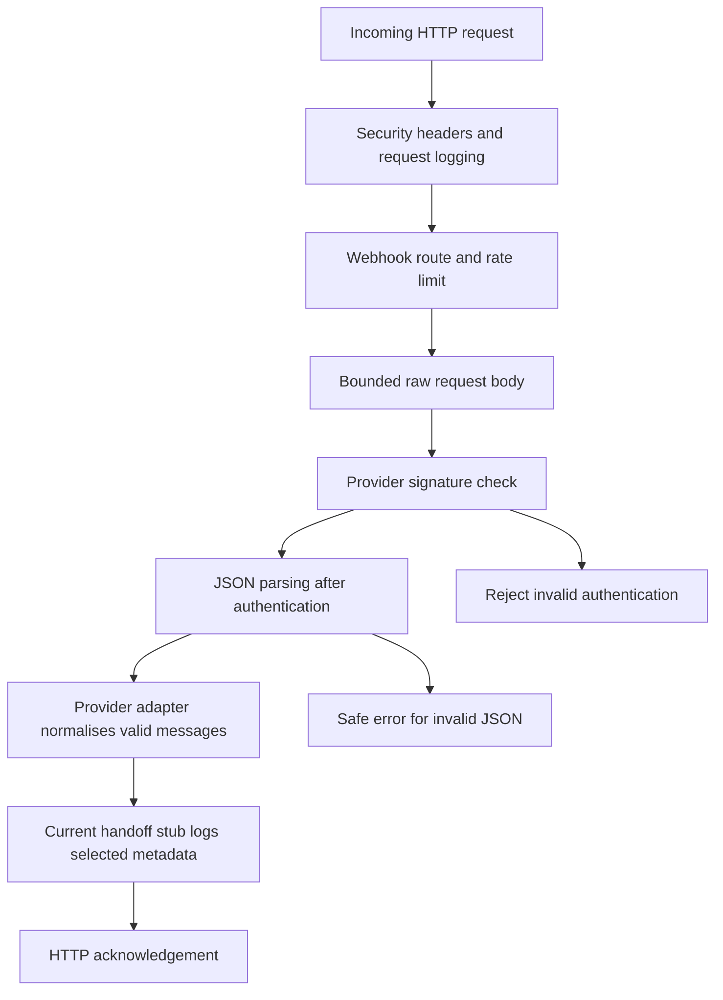

# KNEC Digital Assistant: presentation and revision guide

Prepared: **2026-10-22**. Use alongside the [documentation index](README.md) and [engineering-controls record](engineering-controls.md).

This guide describes the reviewed software foundation and the engineering controls. PR #1 is merged into `main`. The owner approved committing, pushing and opening a pull request for the engineering-controls change on 2026-10-22. Merge approval remains separate. Consult that pull request for current publication and CI status; the verification record in this commit was prepared before publication.

## 1. Start with a precise project description

Suggested opening:

> We are developing a WhatsApp information-assistance platform intended for KNEC-related public information. The repository currently contains a backend foundation, a structured knowledge base, Meta and mock messaging foundations, and automated checks. Twilio connectivity, a live business number, the conversation engine and approved public-answer delivery remain future work. Institutional adoption requires separate technical, content and stakeholder acceptance.

Explain the intended value: a consistent way to receive enquiries, retrieve approved information and eventually escalate cases that require human assistance. Distinguish the intended service from what the current code demonstrates.

## 2. Project status by phase

| Phase | Explain this purpose | Evidence available | Open work |
| --- | --- | --- | --- |
| 0: Definition | Establish scope and architecture | Repository project outline; fuller local planning material | Reconcile and approve a portable governing specification |
| 1: Engineering | Make development repeatable and reviewable | Repository, manifests, configuration, tests, CI; new local lint and scanner controls | Formatting, confirmed repository governance and formal acceptance evidence |
| 2: Knowledge | Store information with provenance metadata | Seven JSON articles and a required-field validator | Full schema, content-owner review and publication rules |
| 3: Backend | Handle requests through defined components | Express app, health endpoint, repository/service layers, logging and errors | Operational ownership, retention/access decisions and production acceptance |
| 4: Messaging | Establish provider interfaces and webhook boundaries | Meta/mock foundation; authentication, limits, safe errors and offline tests | Twilio implementation, durable processing, live exchange and production onboarding |
| 5 onward | Add conversation and information-delivery capabilities | Roadmap and planned interfaces | Menu/state engine, integrated answers, escalation, deployment and stakeholder review |

The Phase 1-3 reports were written retrospectively on 2026-10-20. Describe them as reconstructed implementation evidence, not original sign-off documents.

## 3. Understand the present request flow

This is a simplified explanation of the current Meta webhook path, not the proposed Twilio form route. The raw bytes matter because signature verification depends on the exact received body. Normalisation gives downstream code a common message representation.

The handoff is currently a stub. It does not select an approved KB answer or send an automatic reply. The presence of an outbound adapter method does not establish that the inbound flow calls it. In-memory handling also does not provide durable delivery guarantees after a process crash.

### Files to recognise in VS Code

| File or area | Plain-language explanation |
| --- | --- |
| `src/app.js` | Assembles application middleware and routes |
| `src/config/index.js` | Validates startup settings and rejects unsafe combinations |
| `src/middleware/webhookBody.js` | Controls request-body handling and authenticated JSON parsing |
| `src/middleware/webhookAuth.js` | Applies the selected provider's signature validation |
| `src/services/messaging/metaAdapter.js` | Implements Meta-specific message handling and outbound method |
| `src/services/messaging/mockAdapter.js` | Supports controlled local development without a real provider |
| `src/services/messaging/conversationHandOff.js` | Current downstream stub |
| `src/repository/kbRepository.js` | Loads and indexes the local articles |
| `knowledge-base/` | Stores the seven content records and metadata |
| `tests/` | Contains the existing automated scenarios and synthetic settings |
| `.github/workflows/ci.yml` | Defines checks GitHub runs for a published revision |

## 4. Explain the new engineering controls

### Linting

Suggested explanation: “Linting reads our JavaScript against explicit rules. It can identify an undefined variable before that line is reached during execution. Our configured command treats warnings as failures, and narrow exceptions are documented.”

The lint command does not run the WhatsApp service or automatically rewrite the repository. Passing it does not prove every requirement has been implemented.

### Secret scanning

Suggested explanation: “Secret scanning examines the current repository files for supported credential patterns. Our runner also rejects tracked private environment filenames. Findings are masked, and a failed scan stops the combined check.”

An ignored local `.env` is a file-management convention, not a full security control. A recognised credential pasted into source or a document can still be found. Arbitrary passwords and historical commits are outside the guarantee of this configured check.

### Tests

Suggested explanation: “Tests exercise defined behaviour using synthetic data and local fake servers. Our current application suite contains 77 passing tests. They cover examples such as invalid signatures, request limits, configuration rejection, safe errors and outbound timeouts.”

The test count is evidence of executed assertions. It is not a percentage of production readiness. The original smoke test is an arithmetic assertion; do not describe that particular test as application-startup proof.

### Continuous integration

Suggested explanation: “CI reruns the recorded installation and checks on GitHub for a particular revision. This helps reviewers reproduce local results. Whether it blocks a merge depends on the repository's required-check rules.”

The new workflow has been prepared locally. Its remote result must be observed after an approved push. Existing successful CI evidence for PR #1 does not prove that the new configuration has run remotely.

## 5. Suggested ten-minute presentation

| Time | Topic | What to show |
| --- | --- | --- |
| 0-1 minute | Problem, intended users and service boundary | Precise opening description |
| 1-2 minutes | Phase status | Phase table and outstanding work |
| 2-4 minutes | Architecture and current message path | Flow diagram and adapter/handoff files |
| 4-6 minutes | Security and engineering controls | Configuration, safe errors, lint/scanner setup |
| 6-8 minutes | Evidence | Review record, actual check output and relevant test names |
| 8-9 minutes | Knowledge quality and operational gaps | Unverified content status, durability and ownership requirements |
| 9-10 minutes | Next approved decision | Review/publication, followed by a separately bounded offline Twilio proposal |

Practise explaining the purpose of each layer before its filename. If asked to demonstrate a capability that is still planned, show its plan and status clearly.

## 6. Safe demonstration sequence

Prepare the software and dependencies before presenting. Use the one-command-at-a-time instructions in the [operating guide](engineering-controls.md#6-local-workflow-windows-and-powershell).

1. Show `git status --short --branch`, identify the branch, and state whether the change is local, published or merged.
2. Open `docs/README.md` so the audience can find the phase reports.
3. Open the lint configuration and explain one rule and one justified exception.
4. Run `npm run lint` and explain its actual exit result.
5. Open the scanner configuration and runner; run `npm run scan:secrets` and explain its working-tree scope.
6. Run `npm run validate-kb`, explaining that required fields do not establish factual approval.
7. Run `npm test`; show the final totals and a few relevant test names.
8. Show the CI workflow and the actual GitHub run for the revision being discussed, if it has been published and checked.
9. End with the outstanding work and the specific decision sought.

Use synthetic data and safe output. Do not open a private `.env`, account settings, access tokens or candidate records during the presentation. A local demonstration of these checks needs no Twilio subscription, phone-number purchase or live message.

## 7. Likely questions and accurate answers

### Is the WhatsApp assistant already live?

No live exchange has been demonstrated in this work. The repository has Meta/mock foundations and a Twilio plan. Live testing and production onboarding require later approved work.

### Why strengthen Phase 1 controls while working on Phase 4?

The retrospective review identified an unfinished foundation requirement. Adding repeatable checks now helps protect subsequent integration work. It does not move the project to Phase 5 or close the Phase 4 integration gate.

### Why use both linting and tests?

Linting checks code patterns without exercising application scenarios. Tests exercise selected behaviour. Each can catch mistakes that the other misses.

### Does a green secret scan mean there are no secrets anywhere?

No. It means the selected current files passed the configured detector rules and filename checks. Historical Git objects, staged-only content and unrecognised secret formats need separate attention.

### Will these checks stop every bad merge?

The commands can fail, and CI records that failure. Enforced merge blocking depends on the applicable branch rules and permissions. Those settings have not been certified by this work.

### Has KNEC verified the information in the knowledge base?

No recorded content-owner approval is established by this checkpoint. The seven articles pass a required-field check, while full schema enforcement and factual verification remain open.

### Can the system retrieve a candidate's private results?

No authorised private-record integration is implemented. Such access would require institutional authority, an approved interface and an appropriate identity/access design.

### Is Twilio the same as the WhatsApp business number?

Twilio would provide the messaging integration. A production WhatsApp sender also requires the relevant business ownership and onboarding process. An adapter, a Sandbox and an approved production sender are separate milestones.

### Is this ready for institutional adoption?

The project is being developed towards institutional requirements. Adoption still depends on verified content, reliable delivery and recovery, operational ownership, security review, approved live integration and stakeholder acceptance. Current tests alone cannot establish those conditions.

### What happens next?

Publication and pull-request creation are approved. Review the published change and its GitHub checks before deciding whether to merge it. Then agree the offline Twilio implementation scope. Durable processing and a controlled live test follow their own design and approval gates.

## 8. Short glossary

| Term | Meaning in this project |
| --- | --- |
| Adapter | A component translating a provider's API and messages into the application's expected interface |
| Webhook | An HTTP request a provider sends to our configured endpoint when an event occurs |
| Signature | A cryptographic value used to check that a request matches the expected sender's shared secret and signed data |
| Lint | Static checks against explicit source-code rules |
| Secret | A credential that grants access or authenticates requests and must not be published |
| Fixture | Deliberately controlled sample data used by tests |
| Lockfile | The recorded package dependency resolution used for reproducible installation |
| CI | Automated checks run for a published code revision |
| Branch | A line of development kept separately from another branch such as `main` |
| Commit | A recorded Git snapshot with an identifier |
| Push | Publishing commits to a remote repository |
| Pull request | A review proposal to bring one branch's changes into another |
| Merge | Incorporating approved branch history into its destination |
| Durable processing | Keeping accepted work in persistent storage so it can survive a process restart |
| Idempotency | Ensuring repeated processing of the same operation does not create unintended duplicate effects |

## 9. Final revision checklist

- Can I describe what is implemented, what is only planned and what has actually been tested?
- Can I trace a message through the current webhook path without claiming an automatic KB reply exists?
- Can I explain why seven structurally valid articles are not seven approved articles?
- Can I distinguish local changes, a push, a successful CI run and a merge?
- Can I explain the limits of linting, secret scanning and the 77-test result?
- Can I name the next decision and the evidence needed before it?

Use the technical [engineering-controls record](engineering-controls.md#9-verification-and-acceptance-record) for exact implementation evidence. Use the phase reports for historical context. Keep both current as approved work progresses.
